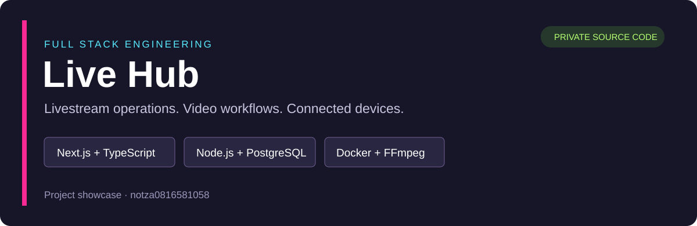
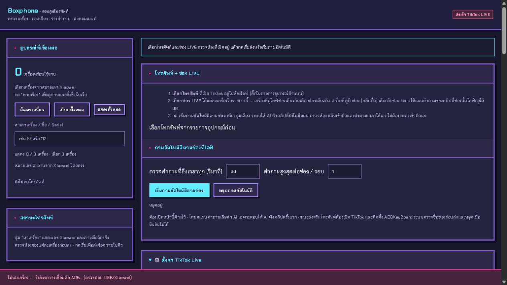
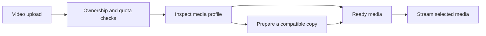
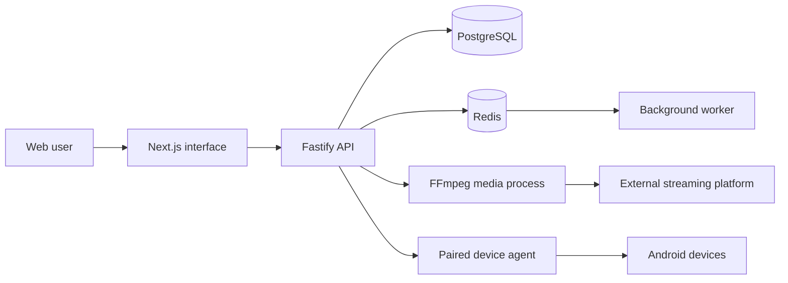

# Live Hub — Full Stack Engineering Portfolio

**A web application for managing livestream operations, video libraries, product workflows, and connected Android devices from one workspace.**

ระบบจัดการงานไลฟ์ผ่านเว็บ ครอบคลุมบัญชีผู้ใช้ คลังวิดีโอ การตั้งเวลารอบไลฟ์ ชุดสินค้า และเครื่องมือเชื่อมต่อมือถือ พัฒนาด้วย TypeScript แบบ monorepo และรันผ่าน Docker Compose

This repository is a **public project showcase** for job applications. Application source code is maintained separately in a private repository. The screenshot shows the local device interface without account credentials or customer information.

## Project at a glance

| Area | Implementation |
| --- | --- |
| Frontend | Next.js 16, React 19, TypeScript |
| Backend | Node.js 22, Fastify, typed API contracts |
| Data and background services | PostgreSQL, Redis, worker process |
| Video processing | FFmpeg / FFprobe, media validation and preparation workflows |
| Device integration | Android / ADB tooling with a local or paired agent |
| Deployment | Docker Compose, Linux VM, HTTPS reverse proxy |
| Testing | Automated unit, API, access-control, and media workflow tests |

## What the application does

- **Workspace and account management:** administrator and member roles, account assignment, and owner-scoped data access.
- **Video library:** channel-specific media, MP4/MOV upload handling, storage limits, metadata inspection, and preparation of stream-compatible copies.
- **Livestream operations:** FFmpeg streaming, configurable start/stop schedules, per-round video and product selection, and bounded recovery attempts for the original room.
- **Product workflows:** saved product sets, account identity checks, cart operations, and pin workflows that read the platform response before reporting success.
- **Device operations:** connected-device discovery, per-device routing, queue controls, and a web interface for a local/paired agent.
- **Operational visibility:** service health, session state, and separate presentation of saved settings and prior execution warnings.

Platform-dependent operations require valid accounts and sessions. Recovery attempts cannot guarantee that a third-party platform will retain a room. Hardware and live-platform tests are separate from the automated software test suite.

## Application preview

### Connected-device workspace

The local interface shows device discovery, device selection, and connection state. This capture has no devices connected; it is not a claim of a completed hardware test.

### Video preparation workflow

## System design

The API owns authorization and account boundaries. Media processing and device operations are separate from the browser interface. PostgreSQL stores application state; Redis supports background coordination.

## Engineering decisions worth discussing

### Verify identity rather than comparing session strings

The same account can have different valid sessions in separate applications. The product workflow checks the platform's stable user identity when sessions differ, while continuing to reject a different account. Regression tests cover valid alternate sessions, foreign identities, expired sessions, and failed identity checks.

### Keep media preparation separate from an active stream

Video preparation creates a separate media copy. Ownership, channel attribution, storage quotas, and failure cleanup are checked without replacing the file used by a running sender. Tests include concurrent quota admission and video-profile checks.

### Treat execution results separately from settings persistence

Saving a schedule and successfully executing its next round are different events. The UI distinguishes a successful save from a previous round's warning, and preserves that warning for inspection.

### Use bounded recovery and report uncertainty

Recovery is constrained to a configured window and distinguishes the existing room from a new room. Platform responses that do not confirm success remain unverified rather than being reported as successful.

## Verification

Latest local verification: **2 November 2026**.

- Main automated suite: **317 passed, 7 skipped, 0 failed** — 324 tests in total.
- Separate UI notice regression checks: **3 passed**.
- Production build: passed across the web, API, client, shared, and worker workspaces.
- Formatting check: passed.
- Lint: no errors; two existing unused-disable warnings.

Skipped tests require additional integration environments or explicit opt-in, including PostgreSQL and real-media/reconnection scenarios. These numbers are software verification results, not uptime or performance benchmarks.

## Source code and review access

Application source, operational configuration, and implementation details are kept in a **private repository**. A guided demonstration or a discussion of the implementation can be arranged during an interview. Source review is subject to the owner's approval.

For project inquiries, contact [notza0816581058 on GitHub](https://github.com/notza0816581058).

This is an independent application and is not an official TikTok product. Development and iteration used AI-assisted tooling; the engineering discussion above focuses on the implemented behavior and verification evidence.
